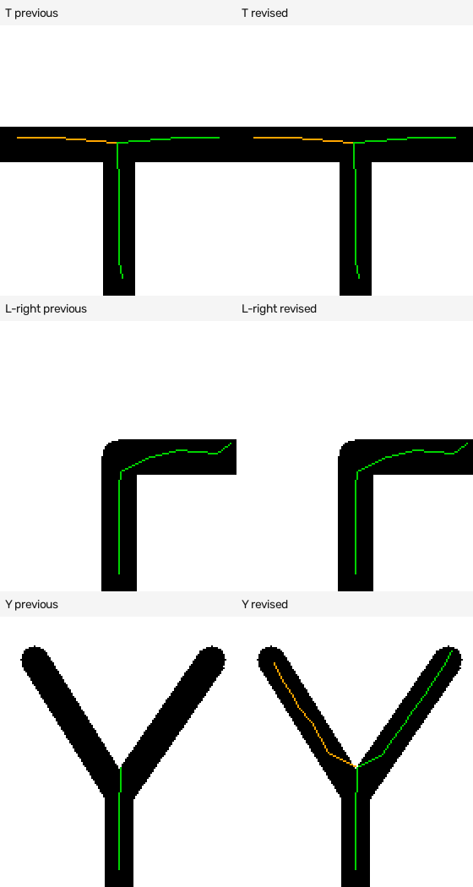

# MaixCAM Radial Line Following

基于固定圆心、前半圆多半径扫描的视觉循迹实验，支持弧心预测、路口分支追踪及左右主路线选择。

Lightweight forward-semicircle radial scanning for MaixCAM, with route prediction and junction branch tracking.

**项目状态：离线实验版。尚未验证 MaixCAM 硬件兼容性、实际帧率或整车闭环表现。**

## 算法思路

1. 灰度、模糊、反向二值化，过滤小连通噪声。
2. 圆心固定在ROI底部中间，按半径由近到远扫描前半圆。
3. 提取道路弧段中点，利用近期方向预测下一扫描层的位置。
4. 按预测距离、极角、方向、沿线道路证据和弱历史评分构建分支树。
5. 保留从近处主干可达的分支，并在分叉处选择左侧或右侧主路线。

分支选择是局部图像几何规则，不是完整地图导航。默认在彩色原图上画绿色主线和橙色其他分支。

## 在 MaixCAM 上使用

将 [`maixcam_radial.py`](maixcam_radial.py) 复制到设备并通过你已有的MaixCAM Python运行方式启动。代码依赖设备环境中的 `maix`、`cv2` 和 `numpy`，保持原有相机与显示API。

**不要在设备上照搬桌面测试依赖安装命令，也不要用同名的普通PyPI包代替设备的Maix运行环境。**

常用设置位于源码顶部：

```python
W, H = 200, 160
THRESHOLD = 70         # 原图灰度<=此值判为黑色道路
ROAD_PIXEL = 255       # 反向二值化后的道路值，通常不改
TURN_MODE = "right"    # 分叉选右；可改"left"
SHOW_BRANCHES = True   # 同时显示其他可达分支
SHOW_DEBUG = False
```

输出仅为视觉结果，不包含电机、舵机、PWM或串口控制。

## 主要增强

- 缓存圆周坐标，减少逐帧重复计算。
- 起步阶段处理偏侧道路的快速极角变化。
- 预测位置、方向和极角联合评分。
- 检查整段道路支持，减少跨白色背景误接。
- 窄直角处尝试经当前图像验证的连接拐点。
- 保留路口增宽前的方向，避免合并弧中点漂移误导转向。
- 分支持续性筛选、有限缺失层处理和虚线缺口显示。
- 弱跨帧关联；当前帧丢失时不继续绘制旧路线。
- 候选/节点上限与大面积黑色异常检测。

详见[参数与设计说明](docs/design.md)。

## 离线测试

以下命令用于桌面Python环境（建议Python 3.10或更新版本），不需要MaixCAM：

```sh
python -m pip install -r requirements-test.txt
python -m unittest discover -s tests -v
```

测试加载视觉函数而不导入或运行Maix SDK。完整主循环的数据流测试使用软件替身，不证明真实硬件接口可用。

测试覆盖直线、S弯、左右直角、T/Y/十字路口、无关旁路、单层/双层缺口、黑白空场、历史失效及彩色输出。另有108组几何输入及对应108组经过模糊、阈值和过滤的输入，共216组构造场景。

早期对比中，[上一版](baselines/radial_previous.py) 在108组二值场景的出口/分支数量判据下通过54组，当前版本通过108组。**这是构造数据上的开发结果，不是实际赛道准确率。** 当前仓库测试可复现几何场景判据。



## 已知限制

- 前半圆、半径递增的扫描方式，对回头弯、侧后方道路和沿路线半径不再增加的情况有几何盲区。
- 固定阈值受光照、阴影和反光影响。
- 路口、拐点和置信度均采用几何启发式，可能误判。
- 路口分支在二值图中断开时，需要依赖有限缺口规则，无法保证拓扑恢复。
- `confidence`不是概率；`error`不是舵机角度；识别路线不等于整车能安全执行。
- 尚无硬件FPS、最坏延迟、功耗或实车成功率数据，不声称优于其他循迹算法。

## 来源与许可

基于 [34758011](https://github.com/34758011) 提供的原始MaixCAM半圆径向扫描代码，使用AI辅助完成工程增强、文档和合成测试。

采用 [MIT License](LICENSE)。MaixCAM SDK、NumPy、OpenCV等依赖遵循各自许可证。
